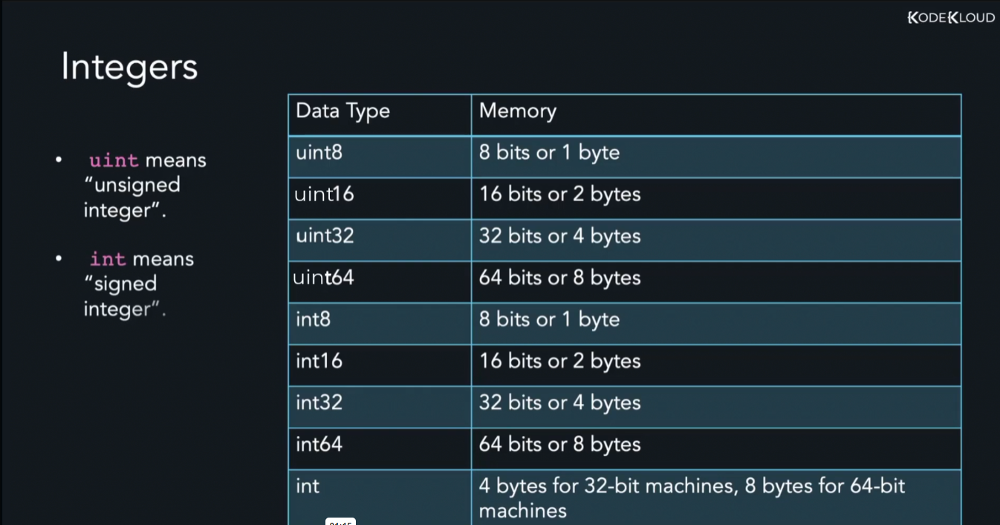
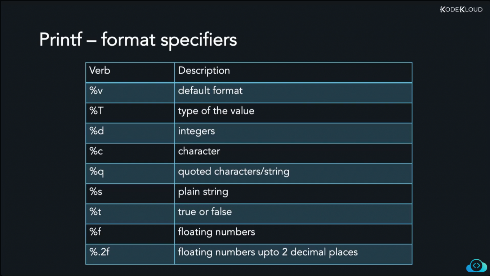
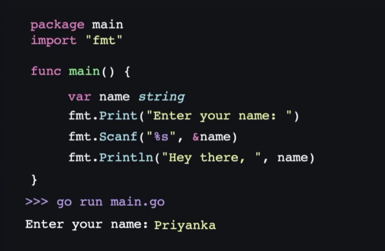
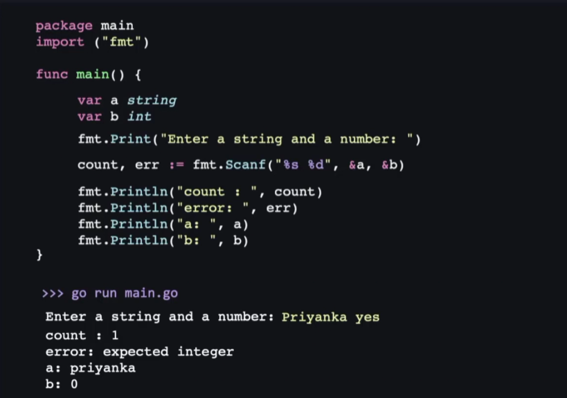
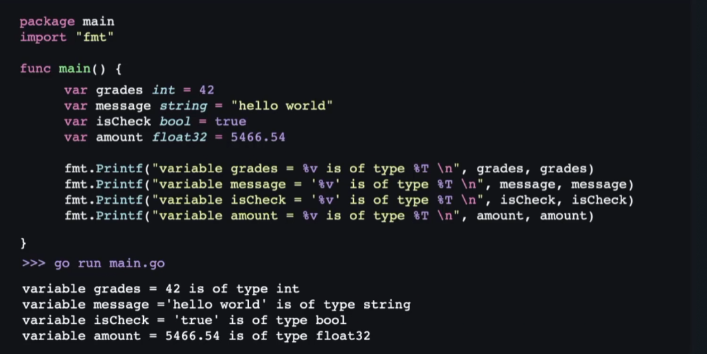
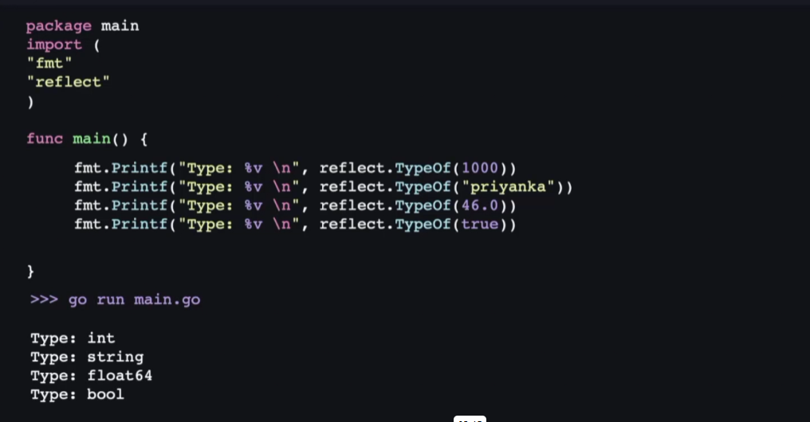
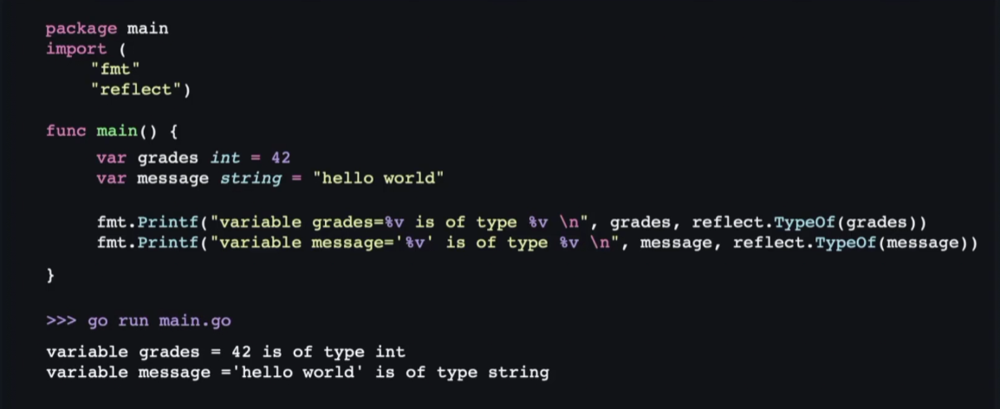
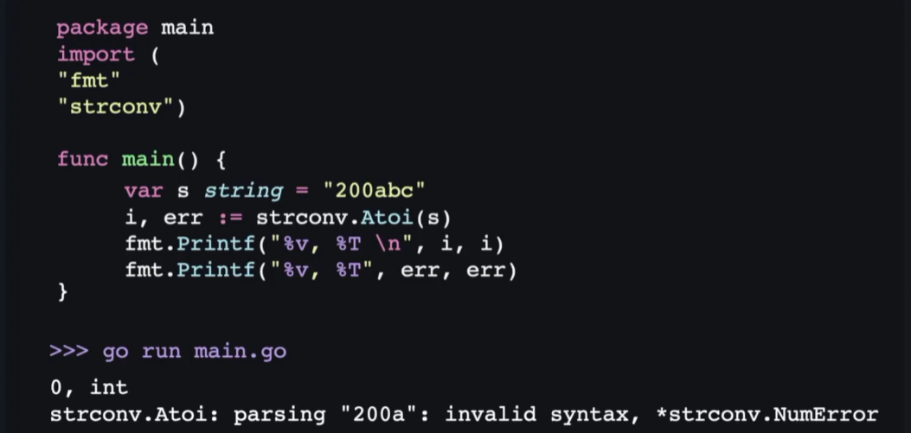

### Data types
1. String
2. Number 
    a. Integers
    b. Float
3. Boolean
4. Arrays and Slices
Arrays: list of single data type
Slices: flexible aray like data type but provides more control over memory allocation.
5. Maps: collection of key value pairs.

### Why we require data types?
1. To catogorize data
2. To make it easier to signify the operations on it.
3. To know how the data should be stored. [memory allocation].

- Go is a static typed language.
 Advantages of static typed:
1. Better performance
2. Bugs can be caught by a compiler
3. Better data integrity.

Static typed: Compiler throws an error when types are used incorrectly.

Go is faster as well as feels like a dynamic typed language.

### Kinds of data types and their declaration
1. Integers
It has different ways of declaration depending on the memory allocation and negative/positive integers.

2. Float
Contains decimal points and are 32bit or 64bit in Go.

3. String
Any sequence of characters , surrounded in quotes, defined using string.

4. Boolean
Defined using bool

### Variables
- Variables are assigned a type either implicitly or explicitly.
var <variable_name> <data_type> = <value>

Printing a variable:
- fmt.Print()  -> it does not print a new line.
- fmt.Println() -> it has a new line.
- fmt.Printf() -> used for print formattings instead of typing each and everything in the print statement.
    example:
    fmt.Printf("Template string %s", Object args(s))

    Format Specifiers:
    

Declaring Variables:
- We also can declare more than one variables in a single line.[shorthandway]
    var s,t string = "foo", "bar"

    var(
    s string = "foo"
    i int = 5)

- Short variable declaration
    s := "Hello"

Variable Scope:
- The scopes are defined or assigned using the Blocks.

    {
        //outer block

        {
            //inner block
        }
    }

- Inner blocks can access variables declared within outer blocks.
- Outer blocks cannot access variables declared within inner blocks.
- Local variables
    - Declared inside a function or a block.
    - Not accessible outside the function or the block.
    - Can also be declared inside looping and conditional statements.

- Global variables
    - Declared outside of a function or a block.
    - available throughout the lifetime of a program.
    - declared at the top of the program outside all functions or blocks.
    - can be accessed from any part of the program.

Zero values:
If a variable is initialized but not assigned with any value, then it is assigned a zero value, it depends upon the data type of the variable.
    bool: false
    int: 0
    float64: 0.00
    string: ""

### User Input
- Scanf is used for userinput 
    fmt.Scanf("%<format specifier> (s)", Object_arguments)

    

    - Scanf returns values:
        - count: the number of arguments that the function writes to
        - err: any error thrown during the execution of the function.
        

### Find the type of variable

1. %T format specifier

2. reflect.TypeOf function from the reflect package

### Converting between data types (Type Casting)

- int(46.89) = 46
- float64(87) = 87.00

`strconv` package
Itoa()
- converts integer to string
- returns one value- string formed with the given integer.

strconv.Itoa(42) = "42"

Atoi()
- converts string to integer
- returns two values - the corresponding integer, error (if any).

### Constants

- Variables whose values once initialized cannot be changed.
    const <const_name> <data_type> = <value>
- shorthand declaration variable is not supported for constants.

